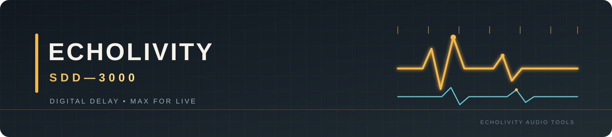
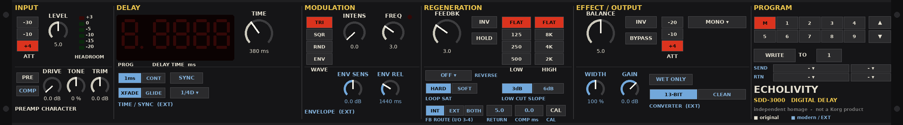

<strong>A digital delay for Ableton Live 12.</strong> Inspired by the character and workflow of the 1982 Korg SDD-3000.

<a href="dist/ECHOLIVITY%20SDD-3000.amxd">Download device</a> · <a href="docs/MANUAL.md">Manual</a> · <a href="docs/INSTALL.md">Installation</a> · <a href="CHANGELOG.md">Changelog</a> · <a href="docs/validation/RELEASE_DECISION.md">Release decision</a>

> **v1.0.2-rc5 · CONDITIONAL PASS**
>
> This is a release candidate, **not a production-ready release**. Automated DSP and static checks are documented, and selected workflows have been tested by the owner in Live 12. Full release validation remains outstanding. Read the [release decision](docs/validation/RELEASE_DECISION.md) before relying on this build in a critical session.

## The instrument

A Max for Live delay built around the sound-shaping and performance workflow of a classic digital rack delay: delay time, regeneration, filtering, modulation and hands-on control. The project combines an independently implemented DSP engine with a native Max for Live interface.

- **Internal and external regeneration paths** — route the feedback loop internally or through external hardware / Live routing.
- **Tempo sync and triplet divisions** — musical divisions alongside time-based operation.
- **Modulation and movement** — LFO, envelope response, vibrato and drift.
- **Feedback tone shaping** — shape repeats inside the regeneration path.
- **Performance controls** — HOLD, program memory and hands-on feedback behaviour.

This is an independent homage, **not** a component-level replica or an official Korg product.

## Download and install

**[Download ECHOLIVITY SDD-3000.amxd](dist/ECHOLIVITY%20SDD-3000.amxd)**

1. Download the single .amxd device.
2. Drag it onto an audio track or return track in Ableton Live 12.
3. Follow the [installation guide](docs/INSTALL.md) and [user manual](docs/MANUAL.md).

## Current release: rc5

- **External loop calibration:** LOOP COMP and CAL help align external regeneration returns to the device delay time.
- **Expanded sync divisions:** 1/16T and 1/32T added without changing existing division indices.
- **Console fix:** UI-2 addresses the Max Console parameter warning caused by the external-loop parameter bank.
- **Owner testing:** Live 12 Suite on Windows confirmed device loading, visible panel, sound without clicks, HOLD, program memory, LFO Mod mapping, external-loop routing and eight instances without dropouts. The newer rc5 controls and remaining checklist items still require explicit validation.

See the [changelog](CHANGELOG.md), [test report](docs/TEST_REPORT.md) and [release decision](docs/validation/RELEASE_DECISION.md) for scope and evidence.

## Listen and inspect

- [Classic echo](audio_examples/01_classic_echo.wav)
- [Dub regeneration sync](audio_examples/03_dub_regeneration_sync.wav)
- [Vibrato](audio_examples/06_vibrato.wav)
- [Random drift](audio_examples/07_random_drift.wav)
- [Filters in the regeneration loop](audio_examples/10_filters_in_loop_LOW500_HIGH2k.wav)
- [Musical evaluation and listening notes](docs/validation/MUSICAL_EVALUATION.md)

These renders are demonstrations, not a substitute for testing the device in your own Live set.

## Documentation

| Guide | Purpose |
|---|---|
| [User manual](docs/MANUAL.md) | Controls, signal flow, operating tips and external loop |
| [Installation](docs/INSTALL.md) | Installation and first-run guidance |
| [Release decision](docs/validation/RELEASE_DECISION.md) | Current go/no-go status and production-release requirements |
| [Live validation checklist](docs/LIVE_VALIDATION_CHECKLIST.md) | Remaining manual tests in Ableton Live |
| [Test report](docs/TEST_REPORT.md) | Engine, static, performance and regression evidence |
| [Outstanding issues](docs/OUTSTANDING_ISSUES.md) | Known limitations and unresolved defects |
| [Engineering changes](docs/ENGINEERING_CHANGES.md) | Implementation changes and root-cause notes |
| [Musical evaluation](docs/validation/MUSICAL_EVALUATION.md) | Musical listening tests, measurements and proposals |
| [Research notes](docs/RESEARCH_NOTES.md) | Hardware research and documented distinctions |
| [Output protection](docs/OUTPUT_PROTECTION.md) | Output saturation and protection behaviour |
| [Visual identity](docs/brand/README.md) | Project palette and asset usage |
| [Documentation index](docs/README.md) | Central guide index |

## Validation snapshot

| Check | Current result |
|---|---|
| Engine tests (C build of exact gen~ code) | 50 PASS · 1 known-limitation FAIL · 51 total |
| Static device checks | 20/20 PASS (static inspection) |
| Reproducibility | 8/8 PASS |
| Ableton Live / Max runtime | Selected owner checks PASS; remaining items outstanding |
| Release decision | **Conditional pass — not production-ready** |

The test report distinguishes automated evidence from host-runtime checks. CPU figures from the C test build are not measurements of Live or Max performance. See [TEST_REPORT.md](docs/TEST_REPORT.md) for detail.

## Rebuild and test

**Requirements:** Python 3.9+ with NumPy and SciPy, plus a C compiler. The documented toolchain is tested on Linux; Windows (MinGW-w64) and macOS (clang) are not verified.

~~~bash
python3 tools/make_gen.py
python3 tools/build_amxd.py
python3 tests/run_tests.py
python3 tools/inspect_amxd.py
python3 tools/make_report.py
python3 tools/verify_release.py
~~~

The test runner exits non-zero on an unexpected failure. One known pre-existing limitation (D-3) remains documented; do not interpret a known failure as a clean all-pass result.

## Repository map

- dist/ — packaged Max for Live device.
- src/gen/ — GenExpr DSP source.
- src/max/ — Max patcher source.
- presets/ — factory program bank.
- tests/ and tools/ — validation, build and reporting utilities.
- audio_examples/ — rendered demos and regression audio.
- docs/validation/ — release evidence and reports.
- SHA256SUMS.txt — release checksums.

## License and trademarks

Released under the **GNU General Public License v3.0**; see [LICENSE](LICENSE). The software is provided without warranty.

Korg and SDD-3000 are trademarks of their respective owner. This project is an independent homage and is not affiliated with, endorsed by, or sponsored by Korg.

Copyright © 2026 the ECHOLIVITY authors.
