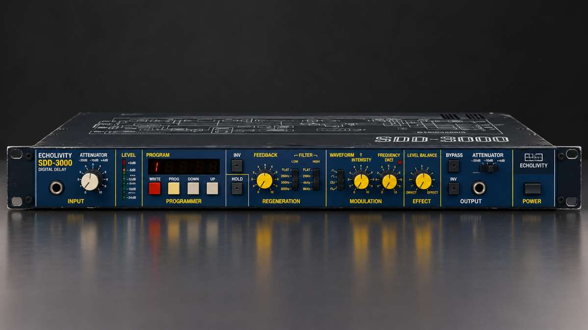

# ECHOLIVITY SDD-3000

<strong>A digital delay for Ableton Live 12.</strong> Inspired by the character and workflow of the 1982 Korg SDD-3000.

<a href="dist/ECHOLIVITY%20SDD-3000.amxd">Download device</a> · <a href="docs/MANUAL.md">Manual</a> · <a href="docs/INSTALL.md">Installation</a> · <a href="CHANGELOG.md">Changelog</a> · <a href="docs/validation/RELEASE_DECISION.md">Release decision</a>

<em>Hardware-inspired concept render. ECHOLIVITY is software only; this is not a product photo or an image of the device's interface.</em>

> **v1.0.2-rc7 · CONDITIONAL PASS**
>
> This is a release candidate, **not a production-ready release**. Automated DSP and static checks pass (one known minor limitation). The owner has tested selected workflows in Live 12 Suite on Windows (rc3/rc4), and the rc6 SEND / RTN routing menus passed all seven native checks in Live 12.4.6 / Max 9. The new rc7 **REVERSE** modes pass offline engine tests but **have not yet been tested in Live**. The DSP findings, including the HW-1 alias images, are still open, as are the remaining Live checklist items and the rc5 controls. Read the [release decision](docs/validation/RELEASE_DECISION.md) before relying on this build in a critical session.

## The instrument

ECHOLIVITY SDD-3000 is a Max for Live digital delay for Ableton Live 12, built around the sound, signal flow and performance workflow of a classic digital rack unit. An independently written gen~ DSP engine models converter character, clock modulation, feedback filtering and hands-on regeneration, and adds modern routing and Live integration.

### Delay and modulation

- **0–1023 ms delay time**, in original-style 1 ms steps or continuously.
- **Tempo sync** to Live: straight (1/32–1/1), dotted (1/8D, 1/4D) and triplet (1/32T, 1/16T, 1/8T, 1/4T, 1/2T) divisions. Synced times are limited to 1023 ms.
- **Two time-change behaviours:** a 25 ms crossfade, or a glide that bends pitch like tape.
- **Four modulation shapes** acting on the memory clock: TRI, SQR, RND and ENV. Uses include flanging, vibrato and doubling (TRI), stepped jumps (SQR), random drift (RND) and envelope-driven pitch bends (ENV).
- **INTENSITY** up to 2:1 (the delay shortens to half), **FREQUENCY** 0.1–15 Hz, and ENV sensitivity (±24 dB) and release (20 ms–5 s).

### Regeneration and tone

- **Feedback routing:** internal (INT), external (EXT) or both combined (BOTH).
- **FEEDBACK** with polarity **INV**. Above 7 the loop builds up to self-oscillation, which the converter keeps bounded.
- **HOLD** freezes the last ~1 s of memory and repeats it indefinitely, while new input is not recorded.
- **REVERSE** (rc7): every repeat backwards (REV), or the direction flipping on each pass (ALT, ALT R). HOLD always plays forwards.
- **LOW (125 / 250 / 500 Hz) and HIGH (8 / 4 / 2 kHz) filters inside the regeneration path**, so each repeat changes tone. LOW cut can use a gentle −3 dB/oct slope or a 6 dB/oct slope.
- **HARD** (converter clipping) or **SOFT** loop saturation. In sustained oscillation the two measure close to each other.
- **Input ranges** −30 / −10 / +4, LEVEL, and a **HEADROOM** meter showing input plus feedback. The converter starts to clip at the red +3, so set LEVEL by the meter.
- **Preamp character stage** (an approximation) with DRIVE, TONE, TRIM and drive compensation; it can be switched off.
- **13-bit gain-ranged converter** character, or **CLEAN**.

### External effects loop

Send the repeats through another Live track's effects (reverb, filters, EQ, distortion…) and back into the delay, so every repeat is processed again.

- **Send** on the device's outputs 3/4 and **return** on its inputs 3/4.
- **Choosing the tracks:** use the **SEND** / **RTN** menus on the panel (rc6, Live 12.2+), or Live's track Input/Output choosers. Confirmed by the owner in Live 12.4.6.
- **INT / EXT / BOTH** modes and a **RETURN** level (same scale as FEEDBACK).
- Each pass through the other track adds Live's routing latency. **CAL** sends one click around the loop and measures that delay; **LOOP COMP** (0–250 ms, also settable by hand) then shortens the internal delay so repeats land on TIME or the synced division.
- **Limits:**
  - LOOP COMP applies in EXT only, not in BOTH.
  - Re-run CAL after changing the buffer size or the effects on the loop track.
  - Delay times shorter than the loop latency can't be fully compensated.
- Routing has been confirmed by the owner in Live. CAL and LOOP COMP are tested in simulation only so far; see the [manual](docs/MANUAL.md#external-regeneration-loop-v102-rc4) for setup and troubleshooting.

### Stereo and output

- **Four output modes:**
  - **MONO**
  - **STEREO A** (direct / mix)
  - **STEREO B** (mix / inverted mix): widest, but the echoes partly cancel in mono
  - **TRUE ST**: separate left and right delay paths sharing the same settings
- **BALANCE** (dry/wet), **WIDTH** (0–200 %, no effect when both channels are identical), output **GAIN** (−24 to +12 dB) and **WET ONLY**.
- Output **INV** flips the echo's polarity against the direct signal (sum ↔ difference). Output range −20 / −10 / +4.
- Output-amp clipping when the character stage is on, plus an always-on safety ceiling (transparent below +6 dBFS, never above +12 dBFS).

### Programs and performance

- **Nine factory programs** plus the manual setting **M**.
- **Program recall**, an edit indicator, and **WRITE** to store your own.
- **What a program stores:** TIME, FEEDBACK, INV, LOW, HIGH, WAVE, INTENSITY, FREQUENCY and BALANCE, plus time mode, sync and division. Input, output and HOLD settings aren't stored.
- Programs are kept with the Live Set and in device presets. Reopening a Set and recalling presets haven't been validated in Live yet.
- **HOLD** and **BYPASS** for performance; BYPASS also clears the loop.

### Ableton Live integration

- All 43 panel controls are Live parameters, available for automation and MIDI, key and macro mapping. Hands-on checks in Live are still partial.
- **Push / Configure banks:** Delay, Character, Modern and Ext Loop.
- **14 continuous controls accept Live's modulators in Mod mode** (Additive: the knob keeps its own value): the 13 knobs plus RETURN. Mapping Live's LFO in Mod mode has been confirmed by the owner. Stepped controls (switches, tabs, menus) can only be mapped with Mod off.

This is an independent homage, **not** a component-level replica or an official Korg product. See the [user manual](docs/MANUAL.md) for the complete control reference, signal flow and operating details.

## Download and install

**[Download ECHOLIVITY SDD-3000.amxd](dist/ECHOLIVITY%20SDD-3000.amxd)**

1. Download the single .amxd device.
2. Drag it onto an audio track or return track in Ableton Live 12.
3. Follow the [installation guide](docs/INSTALL.md) and [user manual](docs/MANUAL.md).

## Current release: rc7

- **REVERSE** menu (owner request): OFF / REV / ALT / ALT R. REVERSE OFF is bit-identical to rc6; one new parameter (Reverse), not stored in programs. Offline engine tests pass; **not yet tested in Live** ([test plan](docs/validation/REVERSE_LIVE_TEST.md)).
- **Not changed by rc7:** HW-1 is not fixed, and the other release blockers remain open.

### Previous release: rc6

- **SEND / RTN routing menus** (Live 12.2+): choose the external-loop send and return tracks from the panel. **Passed 7/7 native checks** by the owner in Live 12.4.6 / Max 9 ([test record](docs/validation/RC6_SEND_RTN_LIVE_TEST.md)). rc6 changes routing only; DSP, parameters and factory programs are unchanged from rc5.
- **Not changed by rc6:** HW-1 (alias images) is not fixed in this build, and the other release blockers listed in the [release decision](docs/validation/RELEASE_DECISION.md) remain open.

### Previous release: rc5

- **External loop calibration:** LOOP COMP and CAL help align external regeneration returns to the device delay time.
- **Expanded sync divisions:** 1/16T and 1/32T added without changing existing division indices.
- **Console fix:** UI-2 addresses the Max Console parameter warning caused by the external-loop parameter bank.
- **Owner testing:** Live 12 Suite on Windows confirmed device loading, visible panel, sound without clicks, HOLD, program memory, LFO Mod mapping, external-loop routing and eight instances without dropouts. The newer rc5 controls and remaining checklist items still require explicit validation.

See the [changelog](CHANGELOG.md), [test report](docs/TEST_REPORT.md) and [release decision](docs/validation/RELEASE_DECISION.md) for scope and evidence.

## Listen and inspect

- [Classic echo](audio_examples/01_classic_echo.wav)
- [Dub regeneration sync](audio_examples/03_dub_regeneration_sync.wav)
- [Vibrato](audio_examples/06_vibrato.wav)
- [Random drift](audio_examples/07_random_drift.wav)
- [Filters in the regeneration loop](audio_examples/10_filters_in_loop_LOW500_HIGH2k.wav)
- [Musical evaluation and listening notes](docs/validation/MUSICAL_EVALUATION.md)

These renders are demonstrations, not a substitute for testing the device in your own Live set.

## Documentation

| Guide | Purpose |
|---|---|
| [User manual](docs/MANUAL.md) | Controls, signal flow, operating tips and external loop |
| [Installation](docs/INSTALL.md) | Installation and first-run guidance |
| [Release decision](docs/validation/RELEASE_DECISION.md) | Current go/no-go status and production-release requirements |
| [Live validation checklist](docs/LIVE_VALIDATION_CHECKLIST.md) | Remaining manual tests in Ableton Live |
| [Test report](docs/TEST_REPORT.md) | Engine, static, performance and regression evidence |
| [Outstanding issues](docs/OUTSTANDING_ISSUES.md) | Known limitations and unresolved defects |
| [Engineering changes](docs/ENGINEERING_CHANGES.md) | Implementation changes and root-cause notes |
| [Musical evaluation](docs/validation/MUSICAL_EVALUATION.md) | Musical listening tests, measurements and proposals |
| [Research notes](docs/RESEARCH_NOTES.md) | Hardware research and documented distinctions |
| [Hardware reference](docs/validation/HARDWARE_REFERENCE.md) | 1982 specification matrix, reference models, measured consistency and open discrepancies |
| [Output protection](docs/OUTPUT_PROTECTION.md) | Output saturation and protection behaviour |
| [Presentation notes](docs/brand/README.md) | Guidance for project imagery |
| [Documentation index](docs/README.md) | Central guide index |

## Validation snapshot

| Check | Current result |
|---|---|
| Engine tests (C build of the exact gen~ code; not Live) | 56 PASS · 1 known-limitation FAIL (D-3) · 57 total |
| Static device checks | 20/20 PASS (static inspection) |
| Reproducibility | 6/7 PASS: rebuild, determinism, tests and renders reproduce; 1 FAIL for a stray experiment file in the tree (`docs/REPRODUCIBILITY.json`) |
| Hardware-reference suite (against the 1982 Korg documentation, not an original unit) | 28 consistent · 5 inconsistent · 9 without a documented reference — see [hardware reference](docs/validation/HARDWARE_REFERENCE.md) |
| Ableton Live / Max runtime | Selected owner checks PASS (rc3/rc4, Windows); rc6 SEND / RTN routing 7/7 PASS (Live 12.4.6); rc7 REVERSE not yet run; remaining items outstanding |
| Release decision | **Conditional pass — not production-ready** |

The test report distinguishes automated evidence from host-runtime checks. CPU figures from the C test build are not measurements of Live or Max performance. See [TEST_REPORT.md](docs/TEST_REPORT.md) for detail.

## Rebuild and test

**Requirements:** Python 3.9+ with NumPy and SciPy, plus a C compiler. The documented toolchain is tested on Linux; Windows (MinGW-w64) and macOS (clang) are not verified.

~~~bash
python3 tools/make_gen.py
python3 tools/build_amxd.py
python3 tests/run_tests.py
python3 tools/inspect_amxd.py
python3 tools/make_report.py
python3 tools/verify_release.py
python3 tests/hwref/hw_validation.py   # optional: hardware-reference suite (~30 s)
~~~

The test runner exits non-zero on an unexpected failure. One known pre-existing limitation (D-3) remains documented; do not interpret a known failure as a clean all-pass result.

## Repository map

- dist/ — packaged Max for Live device.
- src/gen/ — GenExpr DSP source.
- src/max/ — Max patcher source.
- presets/ — factory program bank.
- tests/ and tools/ — validation, build and reporting utilities.
- audio_examples/ — rendered demos and regression audio.
- docs/validation/ — release evidence and reports.
- SHA256SUMS.txt — release checksums.

## License and trademarks

Released under the **GNU General Public License v3.0**; see [LICENSE](LICENSE). The software is provided without warranty.

Korg and SDD-3000 are trademarks of their respective owner. This project is an independent homage and is not affiliated with, endorsed by, or sponsored by Korg.

Copyright © 2026 the ECHOLIVITY authors.
