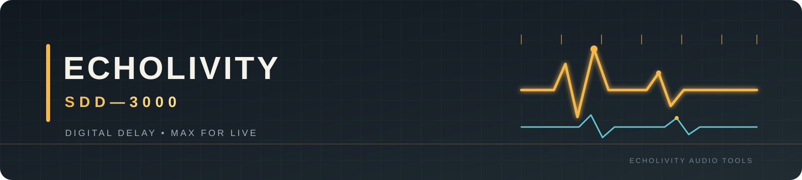

<a href="../README.md">Project home</a> · <a href="MANUAL.md">Manual</a> · <a href="INSTALL.md">Install</a> · <a href="validation/RELEASE_DECISION.md">Release decision</a>

# Documentation index

## Use the device
- [Installation](INSTALL.md)
- [User manual](MANUAL.md)
- [Output protection](OUTPUT_PROTECTION.md)

## Release and validation
- [Release decision](validation/RELEASE_DECISION.md)
- [Live validation checklist](LIVE_VALIDATION_CHECKLIST.md)
- [Test report](TEST_REPORT.md)
- [Outstanding issues](OUTSTANDING_ISSUES.md)
- [DSP regression report](validation/DSP_REGRESSION_REPORT.md)
- [Live integration report](validation/LIVE_INTEGRATION_REPORT.md)
- [Performance report](validation/PERFORMANCE_REPORT.md)
- [Preset compatibility](validation/PRESET_COMPATIBILITY_REPORT.md)

## Engineering and research
- [Engineering changes](ENGINEERING_CHANGES.md)
- [Research notes](RESEARCH_NOTES.md)
- [Musical evaluation](validation/MUSICAL_EVALUATION.md)
- [Visual identity](brand/README.md)
